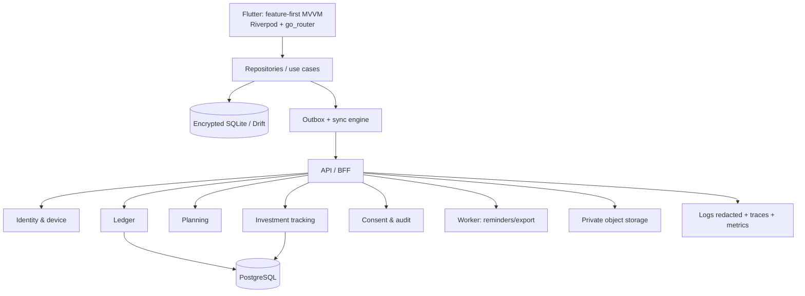

# Kiến trúc, UX, bảo mật và chất lượng phát hành

## 1. Kiến trúc mục tiêu

**Client:** Flutter đa nền tảng, feature-first, View → ViewModel/state → repository/service; domain use case chỉ cho logic phức tạp. SQLite/Drift là nguồn availability offline; Keychain/Android Keystore bảo vệ material mã hóa. Không suy luận “Realm” chỉ vì tên thư mục.

**Server:** modular monolith (NestJS/TypeScript hoặc ASP.NET Core tùy năng lực đội), PostgreSQL, queue, object storage. Chỉ tách service khi ownership/scale có bằng chứng. API REST/OpenAPI, client generation và feature flags.

## 2. Non-functional requirements và SLO

| Nhóm | Release target | Cách chứng minh |
|---|---|---|
| Hiệu năng | cold start p95 ≤2.5s; quick-add offline p95 ≤300ms; dashboard local p95 ≤1s | Device benchmark trên baseline Android/iOS |
| Offline/sync | Local flow hoạt động không mạng; ≥99% mutation sync trong 5 phút sau khi có mạng; zero duplicate | Integration/E2E + telemetry aggregate |
| Backend pilot | ≥99.5% monthly availability, planned maintenance loại trừ | Synthetic/API SLI |
| Data resilience | Backup/restore E2E ≥99%; RPO backup opt-in ≤24h | Restore drill mỗi release |
| Accessibility | Luồng chính hoàn thành tại font scale 200% và TalkBack/VoiceOver | Manual + automated audit |
| Quality | crash-free users ≥99.5%, P1 defects = 0 trước public | Crash dashboard + release gate |
| Observability | 100% API có trace ID; alert sync/error/auth anomaly | Trace sampling & alert test |

## 3. Privacy và threat-model release gates

### Assets / threats / controls

| Asset/flow | Threat | Controls |
|---|---|---|
| Local ledger/receipt | Mất thiết bị, data exfiltration | Encrypt at rest; Keychain/Keystore; app lock; hide app-switcher; private attachment store |
| Auth & sync | ATO/replay/MITM | OAuth2/OIDC PKCE + system browser, token rotation/revoke, TLS, rate limiting; pinning chỉ khi có rotation plan |
| Export/backup | Lộ dữ liệu hoặc backup không khôi phục được | Re-auth, encrypted package, audit, checksum, restore drill |
| Notification | Lộ số tiền màn khóa | Nội dung trung tính default, amount opt-in riêng |
| Analytics/crash | PII leakage | Event allow-list, pseudonymous ID; forbid amount/note/merchant/receipt/account IDs; redaction test |
| Partner/market data | Scope creep/lạm dụng dữ liệu | Explicit granular consent, source license review, revoke/disconnect, minimum scopes |

Gates: threat model trước beta; SAST/dependency/secret scan mỗi PR; API auth/DAST; MASVS control mapping (storage, crypto, auth, network, platform, code, resilience, privacy); pentest trước public release; incident response and disclosure contact.

## 4. UX specification và service blueprint

**Design direction:** Calm, explainable financial cockpit. Màn chính trả lời: *có thể chi bao nhiêu; đã chi vào đâu; hành động nên làm tiếp theo là gì*. Không bắt người dùng làm kế toán; ledger là progressive disclosure.

| Moment | Frontstage | Backstage | Failure mode | UX control |
|---|---|---|---|---|
| Onboarding | Chọn local/cloud, VND, mục tiêu | Local vault/consent | Ép sign-up gây drop | Guest-first, backup explained in plain Vietnamese |
| Quick add | Numeric keypad, default account/category, undo | Atomic local ledger + outbox | Nhập sai/mất mạng | Review visible, undo, “đã lưu trên thiết bị” |
| Budget alert | “Còn X trong Y ngày” | Budget projection | Gây tội lỗi/alert fatigue | Neutral language, configurable frequency, actionable drill-down |
| Deposit tracking | Form → maturity preview | Contract validation/reminder | Hiểu là app mở sổ | Persistent “theo dõi khoản đã mở” label |
| Investment valuation | Price/source/as-of/quality next to value | Quote/FX quality policy | Nhầm estimate với realtime | Stale/missing flag + drill-down provenance |
| Restore/export | Guided confirmation/status | Async job/checksum/audit | Mất dữ liệu | Last backup time, testable restore, clear scope |

Tương tác bắt buộc: touch target đủ lớn; không dùng màu làm tín hiệu duy nhất; dark mode; semantic labels; plain Vietnamese, `₫`, `dd/MM`; load/empty/error/offline states; bottom nav phone và list-detail/rail tablet/foldable.

## 5. Quality strategy

| Tầng | Ví dụ kiểm thử |
|---|---|
| Unit/domain | money precision, transfer double-entry, split, budget, day-count, P&L, maturity, timezone |
| Property based | Reversal không thay đổi ledger invariant; retry không duplicate; balances bền qua chuỗi thao tác |
| Integration | DB migration, crypto key lifecycle, outbox/sync/conflict, authz/idempotency/rate limit |
| E2E | Onboard → 5 transactions → budget → deposit → holding → offline edit → sync → export/restore/delete |
| Device/a11y | Low-end Android, supported iOS/Android, font scale, dark mode, screen reader, poor network |
| Security | SAST/DAST, dependency/secret scan, MASVS assessment, pentest |
| DR | Corrupt DB recovery, lost device, backup restore, mobile rollback/schema compatibility |

## 6. Analytics and operations

North-star: users with ≥3 *financially aware* days/week (record, review or adjust plan) without capturing financial amounts in analytics.

Allowed events: `onboarding_completed`, `account_created`, `transaction_created|edited|reversed`, `budget_created|threshold_reached`, `goal_created|contribution_added`, `deposit_created|maturity_reminder_opened`, `holding_created|valuation_updated`, `sync_succeeded|failed`, `backup_created|restore_succeeded`, `insight_explained|dismissed|acted`, `export_requested`, `delete_requested`.

Required event properties: anonymous/user ID, app version, OS, feature flag, network state, duration/outcome. Prohibited: amount, note, merchant, receipt, account reference.

Runbook must cover dashboard/alert ownership, incident triage, data deletion SLA, key rotation, feature-flag rollback, sync backlog, backup failure and customer-support procedure using trace ID only.

## 7. Compliance boundary

Tracking-only is a product constraint, not a legal conclusion. Before release, obtain Vietnamese legal review for privacy notice, consent/revocation, retention/export/delete, SDK processors and cross-border processing. Any bank/deposit/securities execution needs a separately approved partner, data contract, licensing and operational design (KYC/AML, reconciliation, complaints, fraud, audit); it is not a minor API integration.

Technical references: [OWASP MASVS](https://mas.owasp.org/MASVS/), [Flutter architecture guide](https://docs.flutter.dev/app-architecture/guide), [Apple privacy guidance](https://developer.apple.com/design/human-interface-guidelines/privacy/), [Android accessibility](https://developer.android.com/develop/ui/compose/accessibility), [W3C WCAG 2.2 focus appearance](https://www.w3.org/WAI/WCAG22/Understanding/focus-appearance).
