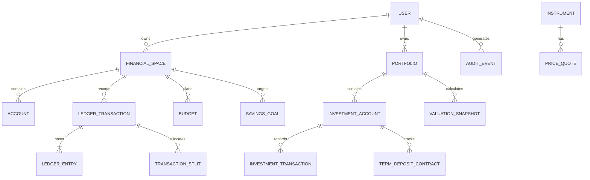
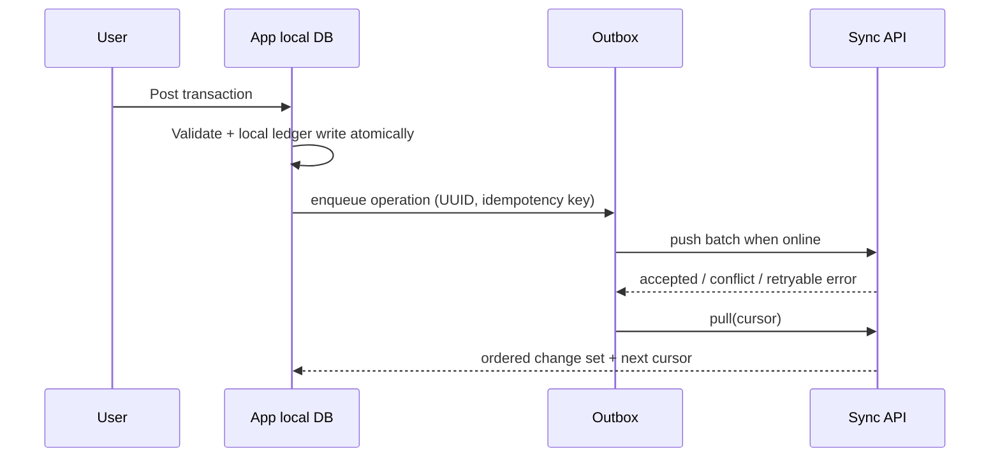

# Domain, dữ liệu, đồng bộ và API contract

## 1. Bounded contexts và ownership

| Context | Aggregate roots | Trách nhiệm |
|---|---|---|
| Identity & Device | User, Device, Session | Auth, khóa thiết bị, recovery, consent |
| Ledger | FinancialSpace, Account, Transaction | Số dư, double-entry, split, transfer, reconciliation |
| Planning | Budget, SavingsGoal | Budget/goal/projection/reminder |
| Investments | Portfolio, DepositContract, Holding, Instrument | Giá vốn, interest forecast, quote/valuation |
| Sync & Audit | SyncOperation, AuditEvent | Idempotency, version, outbox, immutable audit |
| Notification | NotificationPreference, Reminder | Scheduling và notification privacy |

## 2. ERD logic



## 3. Data dictionary thiết yếu

| Entity | Trường bắt buộc | Invariants |
|---|---|---|
| `accounts` | id, space_id, type, name, currency_code, opening_balance_minor, opening_balance_at, status | Không hard-delete khi có ledger entry; VND integer; type xác định display logic |
| `ledger_transactions` | id, space_id, type, status, occurred_at, source_type, idempotency_key, version | Status posted bất biến nghiệp vụ; unique space + idempotency key |
| `ledger_entries` | id, transaction_id, account_id, direction, amount_minor, currency_code, entry_type | amount > 0; posted transaction phải cân bằng theo mô hình entry chuẩn |
| `transaction_splits` | id, transaction_id, category_id, amount_minor | Tổng split = principal của income/expense; không áp dụng transfer |
| `budgets` | id, space_id, period, starts_at, limit_minor, currency | Scope category/account rõ; limit > 0 |
| `term_deposit_contracts` | id, account_id, principal_minor, annual_rate, start_date, maturity_date, day_count_basis, payout_frequency, status | maturity > start; trạng thái matured không ngầm renew |
| `instruments` | id, asset_type, name, currency, unit_precision, price_precision | Asset type and quote policy rõ |
| `investment_transactions` | id, account_id, instrument_id, type, trade_at, quantity, gross_minor, fee_minor, tax_minor, currency, status | Quantity/amount direction do type; sell no-short không âm holding |
| `price_quotes` | id, instrument_id, quoted_at, received_at, price_minor, currency, source, quality | Quote provenance bắt buộc; không update historic row |
| `valuation_snapshots` | id, portfolio_id, as_of_at, base_currency, market_value_minor, coverage_ratio, price_cutoff_at, fx_cutoff_at | Derived/cache; ledger + quotes là nguồn tái tạo |
| `audit_events` | id, actor_id, entity_type/id, action, occurred_at, correlation_id, before_hash, after_hash | Append-only; payload redacted/minimized |

### Quy ước dữ liệu

- UUID v7/client-generated UUID; `created_at`, `updated_at` UTC ISO-8601; business date giữ local date và IANA timezone.
- Amount/price dùng integer minor units hoặc decimal fixed precision; API mô tả rõ scale. Không truyền float.
- Mã currency ISO 4217. FX quote lưu cặp, rate, `as_of_at`, source; historical transaction giữ snapshot rate.
- `external_reference` chỉ token/masked form; không lưu full bank/card identifier vào note/log.
- Soft delete chỉ với draft/user metadata; post transaction dùng reversal/adjustment.

## 4. Offline-first & sync contract

**Source of availability:** encrypted local SQLite/Drift. **Source of cloud backup/sync khi opt-in:** server. Client ghi local transaction trước, sau đó gửi outbox; không đợi mạng để xác nhận ghi chi.



1. Mỗi mutation có `operationId`, `entityId`, `baseVersion`, idempotency key và timestamp local.
2. Push retry an toàn: cùng key phải trả cùng result, không tạo duplicate ledger transaction.
3. Pull cursor opaque; server trả changes đã sắp thứ tự và tombstone cần thiết. Không dùng offset pagination cho sync/history.
4. Conflict `409` trả `serverVersion`, `clientBaseVersion`, server/client snapshots đã redacted và suggested strategy. Với posted ledger, không last-write-wins: tạo adjustment hoặc yêu cầu review.
5. Xóa cloud data không xóa local copy một cách âm thầm; app hiển thị rõ phạm vi xóa. Revoke consent ngừng sync mới ngay.

## 5. REST API outline

Tất cả endpoint `/v1`, JSON UTF-8, TLS; access token; mutation yêu cầu `Idempotency-Key`, `X-Device-Id`, `X-Correlation-Id`. Error body chuẩn:

```json
{"code":"VALIDATION_ERROR","message":"Request is invalid","fieldErrors":[{"field":"amountMinor","code":"GT_ZERO"}],"traceId":"...","retryable":false}
```

| Method / endpoint | Mục đích | Điều kiện chính |
|---|---|---|
| `POST /accounts` | Tạo account | currency/type/name validate |
| `GET /accounts` | Danh sách account | cursor/page limit; masked data |
| `POST /transactions` | Tạo income/expense/split | balance/split/category/idempotency validate |
| `POST /transfers` | Tạo transfer | source ≠ target; hai legs atomic |
| `POST /transactions/{id}/reverse` | Đảo giao dịch posted | reason required; không destroy history |
| `GET /transactions` | Lịch sử | filter account/category/status/from/to + cursor |
| `POST /reconciliations` | Mở/hoàn tất đối soát | closing date/balance required |
| `POST /budgets` / `GET /budgets/progress` | Budget | report timezone explicit |
| `POST /goals` / `POST /goals/{id}/contributions` | Goal | confirmed versus planned explicit |
| `POST /term-deposits` | Tracking contract | preview/assumptions in response |
| `POST /investment-transactions` | Buy/sell/dividend etc. | no-short/cost policy validation |
| `POST /valuations` / `GET /portfolio/valuation` | Snapshot/query valuation | as-of, coverage/source/staleness mandatory |
| `POST /sync/push` / `GET /sync/pull` | Đồng bộ | batch limit + opaque cursor |
| `POST /data-exports` / `DELETE /account-data` | Quyền dữ liệu | re-auth, audit, async job status |
| `POST /consents/{id}/revoke` | Rút consent | immediate scope stop + audit |

### Ví dụ payload: transfer

```json
{
  "occurredAt":"2026-10-11T09:30:00+07:00",
  "sourceAccountId":"...",
  "destinationAccountId":"...",
  "amountMinor":2000000,
  "currency":"VND",
  "feeMinor":11000,
  "feeCategoryId":"...",
  "note":"Nạp ví",
  "clientOperationId":"..."
}
```

### Ví dụ response: valuation

```json
{
  "asOf":"2026-10-11T10:00:00Z",
  "baseCurrency":"VND",
  "marketValueMinor":125000000,
  "costValueMinor":118000000,
  "unrealizedPnlMinor":7000000,
  "coverageRatio":"0.92",
  "priceCutoffAt":"2026-10-10T16:00:00Z",
  "fxCutoffAt":"2026-10-11T09:00:00Z",
  "dataQualityFlags":["STALE_QUOTE","MISSING_FX"]
}
```

## 6. API security and compatibility

- Authorization server-side theo user/financial space; client-supplied owner IDs không được tin cậy.
- Rate-limit theo account/device/IP; error `429` có retry metadata. Pagination default/maximum hữu hạn.
- Contract tests/OpenAPI generated client; breaking change chỉ qua major API. Additive fields phải backward-compatible.
- Không ghi amount, merchant, note, receipt, account identifier vào trace/analytics. `traceId` cho support không chứa PII.
- Attachment upload dùng short-lived pre-signed URL, content-type/size allow-list, malware scan và object key không đoán được.

## 7. Tính toán định giá/interest — test vectors bắt buộc

- VND amount, multi-currency FX snapshot, round-half policy.
- Leap year và mọi `day_count_basis`; start/maturity ở timezone edge.
- Quote stale/missing, FX missing, price after valuation cutoff.
- Partial sell, fee/tax, dividend, reversal và idempotent retry.
- Allocation một holding cho nhiều goal không vượt 100%.
- Transfer fee, credit-card payment và split phải bảo toàn ledger invariant.
