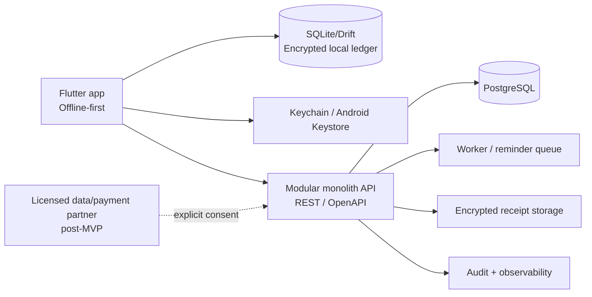

# Kế hoạch sản phẩm — Ví tài chính cá nhân

> Phiên bản: 11/10/2026 · Thị trường đầu tiên: Việt Nam

## 1. Quyết định sản phẩm

Ra mắt như một **ứng dụng quản lý tài chính cá nhân (PFM) local-first**, không phải ví điện tử theo nghĩa pháp lý: ứng dụng không giữ tiền, không chuyển tiền, không cho vay và không kết nối bằng thông tin đăng nhập ngân hàng. Giá trị cốt lõi là: *biết tiền đã đi đâu, còn bao nhiêu đến kỳ lương và đạt mục tiêu tiết kiệm*.

Định vị này giảm đáng kể phạm vi cấp phép/thanh toán ở giai đoạn đầu, tạo nền tin cậy trước khi đầu tư vào kết nối dữ liệu hay dịch vụ tài chính được cấp phép.

## 2. Người dùng và JTBD

| Phân khúc | Nỗi đau chính | Việc cần hoàn thành |
|---|---|---|
| 18–30, sinh viên/người đi làm | Chi nhỏ qua QR/e-wallet khó tổng hợp | Ghi nhanh, biết còn bao nhiêu để chi, tránh vượt ngân sách |
| 25–40, gia đình trẻ | Hóa đơn và mục tiêu dài hạn bị phân tán | Lập ngân sách gia đình, nhắc hạn, dành quỹ khẩn cấp |
| Freelancer/tiểu thương | Thu nhập không đều, lẫn tiền cá nhân/công việc | Xem dòng tiền và lập mức chi an toàn |

Beachhead: nhóm 18–30. Chưa nhắm người cần đầu tư, tín dụng hay giao dịch thanh toán ở MVP.

## 3. SWOT

| Điểm mạnh | Điểm yếu |
|---|---|
| Local-first và riêng tư; danh mục, VND, chu kỳ nhận lương theo Việt Nam; thao tác QR/mobile-first; hoạt động offline | Nhập tay dễ gây bỏ cuộc; thiếu dữ liệu giao dịch tự động; thương hiệu mới phải xây niềm tin; chi phí bảo mật và hỗ trợ cao |
| Cơ hội | Thách thức |
| Nhu cầu nhìn toàn cảnh chi tiêu trong bối cảnh thanh toán số; AI có thể phân loại/giải thích có kiểm soát; hợp tác payroll/ngân hàng về sau | Ứng dụng ngân hàng/e-wallet đã có tệp khách hàng; phishing/account takeover; API đối tác và pháp lý thay đổi; AI sai gây mất niềm tin |

Chiến lược: dùng “minh bạch + quyền kiểm soát” làm khác biệt, thay vì chạy theo “AI tự động mọi thứ”.

## 4. MVP (8–12 tuần)

### Trong phạm vi

- Onboarding tiếng Việt: VND, ngày nhận lương, mục tiêu; chọn dùng chỉ trên máy hoặc sao lưu đám mây opt-in.
- Nhiều nguồn tiền thủ công: tiền mặt, tài khoản, e-wallet.
- Ghi thu/chi trong tối đa 3 thao tác; danh mục, ghi chú, ngày, ảnh hóa đơn tùy chọn; sửa và hoàn tác.
- Tổng quan: số dư, dòng tiền tháng, ngày đến kỳ lương, một insight có thể hành động.
- Ngân sách theo danh mục, mục tiêu tiết kiệm, giao dịch/nhắc nhở định kỳ.
- Danh sách giao dịch, tìm kiếm/lọc, báo cáo tháng, xuất CSV/JSON.
- App lock biometric/PIN, Trust Center (dữ liệu lưu đâu, export, xóa dữ liệu), thông báo không lộ số tiền trên lock screen.

### Không làm trong MVP

Kết nối ngân hàng/e-wallet tự động; giữ/chuyển tiền; cho vay/chấm điểm; tư vấn đầu tư; chia sẻ gia đình; OCR hoặc AI đám mây mặc định.

## 5. Trải nghiệm và thiết kế

**Hướng thiết kế: _Calm, explainable financial cockpit_.** Giao diện sáng, ít nhiễu, ưu tiên số tiền và hành động tiếp theo. Chỉ dùng một màu thương hiệu cho hành động chính; trạng thái thu/chi phải kết hợp nhãn và icon, không chỉ màu.

### Điều hướng và màn hình

- 4 tab: **Tổng quan · Giao dịch · Kế hoạch · Hồ sơ**; hành động “Thêm giao dịch” luôn ở vị trí dễ chạm.
- Home: số dư có thể ẩn/hiện, quick add, cashflow tháng, “Cần chú ý” (hóa đơn/khả năng vượt ngân sách), insight có nút “Vì sao?” và “Bỏ qua”.
- Luồng ghi giao dịch: số tiền → danh mục/nguồn tiền → chi tiết tùy chọn → xem ảnh hưởng ngân sách → lưu → biên nhận + hoàn tác.
- Tablet/foldable: navigation rail và bố cục danh sách–chi tiết; điện thoại dùng bottom navigation.
- Hỗ trợ dark mode, Dynamic Type/font scaling, VoiceOver/TalkBack, contrast tốt, trạng thái loading/empty/error/offline đầy đủ, định dạng `vi-VN`, `₫`, `dd/MM`.

Không dùng dark pattern. Mọi insight AI phải giải thích dữ liệu/logic, có thể tắt và **không tự thực thi** hành động tài chính.

## 6. Kiến trúc đề xuất

- **Mobile:** Flutter/Dart, feature-first, MVVM/Clean nhẹ: View → ViewModel/state → repository/service; use case chỉ cho nghiệp vụ phức tạp. Riverpod, go_router, immutable models.
- **Dữ liệu:** SQLite/Drift cho ledger, migration/audit; giao dịch append-only; đồng bộ outbox có idempotency key. Tiền lưu integer minor units/decimal và currency ISO; thời gian UTC.
- **Backend:** NestJS/TypeScript hoặc ASP.NET Core theo năng lực đội ngũ; PostgreSQL, Redis rate limiting, object storage; modular monolith trước, chưa microservices.
- **Bounded contexts:** Identity & device, Ledger, Classification, Budget & Goals, Insights, Notifications, Consent/Integrations.
- **Bảo mật:** biometric/PIN, OAuth2/OIDC PKCE nếu có cloud account, token rotation, TLS, mã hóa dữ liệu/backup, session thiết bị, audit log; secrets chỉ trong Keychain/Keystore hoặc vault.

## 7. Cổng an toàn và tuân thủ

Đây không phải tư vấn pháp lý. Trước public launch cần luật sư Việt Nam rà soát thông báo quyền riêng tư, cơ sở xử lý dữ liệu, consent có thể rút lại, retention/xóa/export, processor/SDK và luồng dữ liệu xuyên biên giới. Bất kỳ tính năng nhận/giữ/chuyển tiền nào chỉ được cân nhắc cùng tổ chức/đối tác có giấy phép phù hợp.

Release gate tối thiểu: threat model; MASVS L1 checklist; không log PII/tài chính; dependency/SAST scan; kiểm thử backup/restore; pentest trước phát hành rộng; quy trình incident response và kênh báo lỗi bảo mật.

## 8. Lộ trình và tiêu chí quyết định

| Giai đoạn | Thời lượng | Kết quả |
|---|---:|---|
| P0 — Discovery | 1–2 tuần | 20–30 phỏng vấn, data map/consent, threat model, prototype test 5–8 người, KPI được chốt |
| P1 — Foundation | 2 tuần | Design tokens, a11y baseline, schema/API contract, CI/CD, observability, app lock |
| P2 — Core | 3 tuần | Accounts, thu/chi, category, list/search/filter, offline/sync, onboarding |
| P3 — Control | 2 tuần | Budget, goals, recurring/reminders, dashboard cashflow |
| P4 — Pilot | 1–2 tuần | MASVS/a11y/performance, beta 20–50 người, sửa lỗi và đo lường |
| P5 — Smart features | 6–10 tuần | OCR opt-in, phân loại có xác nhận, insight giải thích được, chia sẻ gia đình theo consent |
| P6 — Partner integration | Sau gate | Data sync/embedded payments chỉ qua đối tác được cấp phép và qua legal/security review |

KPI pilot: activation = tạo ≥5 giao dịch + 1 ngân sách trong 24h; D7/D30 retention; số ngày ghi giao dịch/tuần; budget adherence; tỷ lệ sửa phân loại; NPS Trust. Chỉ mở bank sync khi D30 và tần suất sử dụng vượt ngưỡng do đội sản phẩm định trước.

## 9. Quyết định cần chốt ngay

1. Xác nhận MVP là PFM local-first, không phải ví thanh toán.
2. Chọn ưu tiên Flutter hoặc native/Kotlin–Swift theo năng lực đội ngũ.
3. Chọn mô hình tài khoản: guest local-first hay bắt buộc cloud account.
4. Chốt ngưỡng KPI go/no-go cho pilot và ngân sách cho legal review/pentest.

## Tham chiếu

- Apple HIG: [Design principles](https://developer.apple.com/design/human-interface-guidelines/design-principles) và [Designing for iOS](https://developer.apple.com/design/human-interface-guidelines/designing-for-ios/).
- Android: [Adaptive apps](https://developer.android.com/develop/adaptive-apps/guides/get-started-with-adaptive-apps) và [adaptive navigation](https://developer.android.com/develop/adaptive-apps/guides/build-adaptive-navigation).
- OWASP: [MASVS](https://mas.owasp.org/MASVS/02-Frontispiece/).
- Flutter: [Architecture guide](https://docs.flutter.dev/app-architecture/guide).
- Việt Nam: [văn bản về bảo vệ dữ liệu cá nhân](https://vbpl.vn/TW/Pages/vbpq-toanvan.aspx?ItemID=187276) và [tài liệu NHNN liên quan thanh toán](https://www.sbv.gov.vn/webcenter/ShowProperty?nodeId=%2FUCMServer%2FSBV605026%2F%2FidcPrimaryFile&revision=latestreleased).
